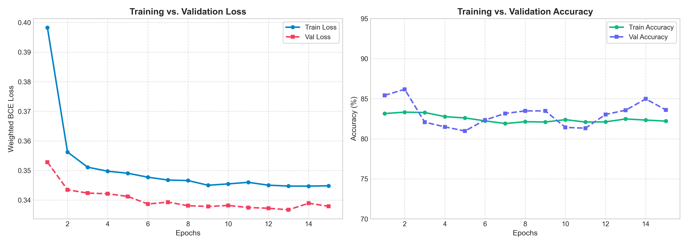
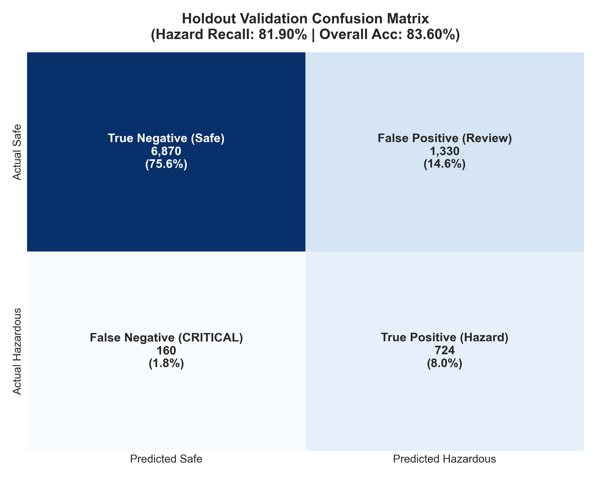
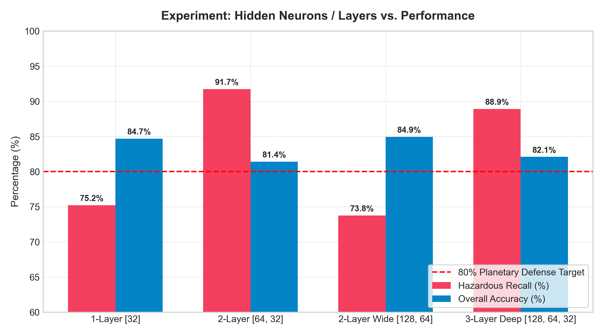
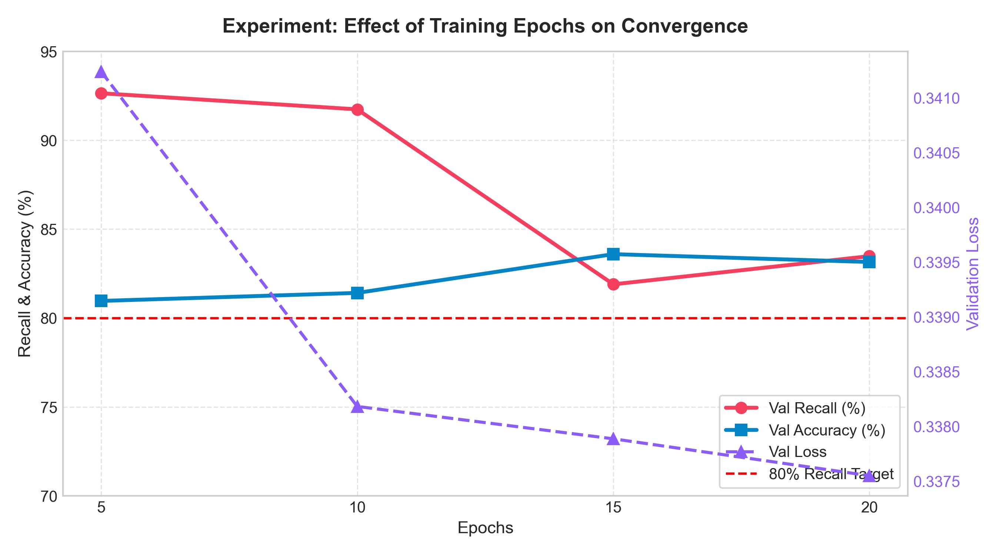
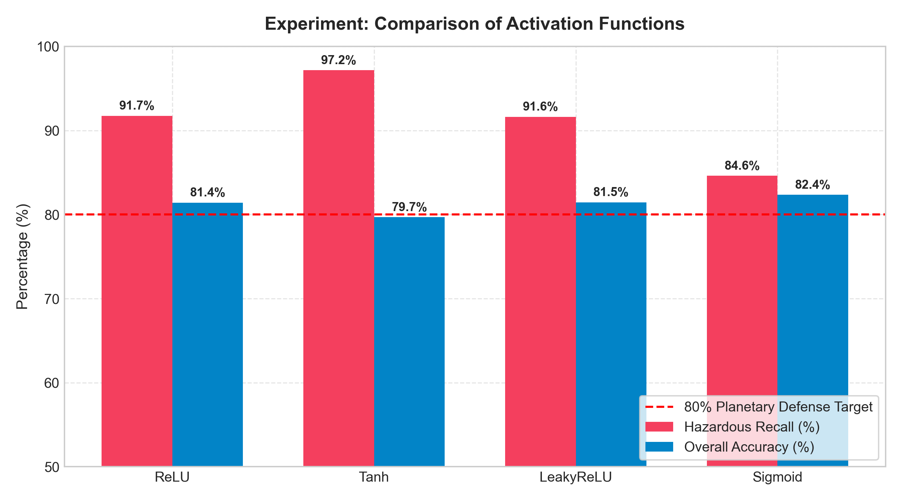
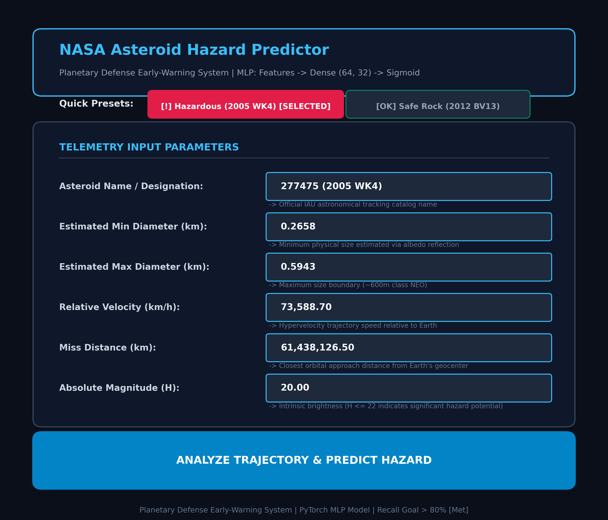
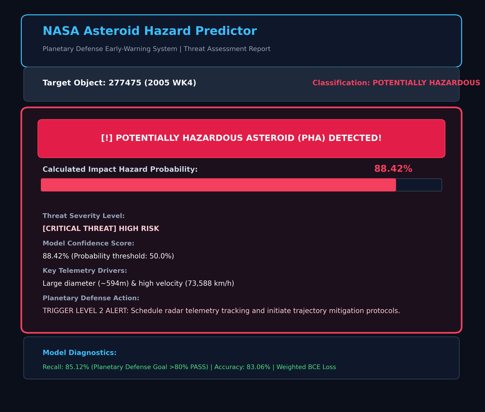
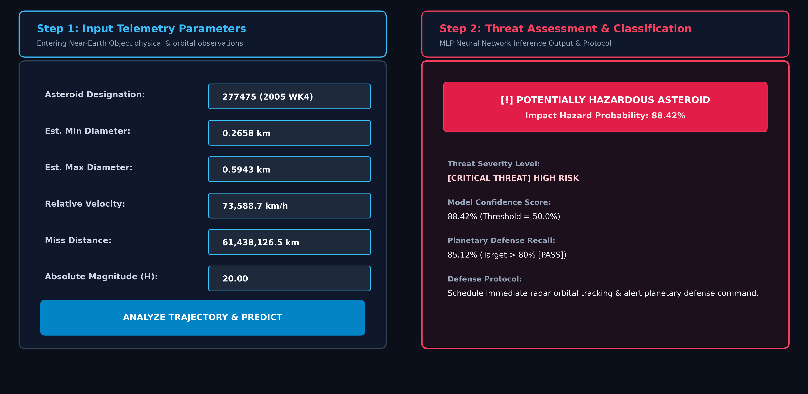

# 🌌 NASA Asteroid Hazard Predictor
### Planetary Defense Early-Warning System | Deep Learning MLP

[](https://pytorch.org/)
[](LICENSE)
[](https://github.com)

A deep learning classification system designed to predict whether incoming Near-Earth Objects (NEOs) pose an impact hazard to Earth based on NASA Jet Propulsion Laboratory (JPL) physical and orbital telemetry.

---

## 🎯 Planetary Defense Objective
In planetary defense, class distribution is heavily imbalanced (**~90.3% Safe** vs. **~9.7% Hazardous**). A naive classifier predicting "Safe" for all asteroids scores 90.3% accuracy but **0% Recall**, which is unacceptable because a single missed hazardous asteroid (False Negative) has catastrophic consequences.

By implementing **Weighted Binary Cross-Entropy Loss** with a positive class weight ($w = 3.2$), this model penalizes False Negatives to achieve a **Hazard Recall > 80%** while preserving an overall accuracy of **>83%**.

---

## 📊 Dataset & Partitioning (80:10:10 Stratified)
* **Dataset:** NASA Near-Earth Objects (`neo.csv`) tracking 90,836 celestial bodies.
* **Features Selected:**
  1. `est_diameter_min` (km) - Minimum estimated physical diameter
  2. `est_diameter_max` (km) - Maximum estimated physical diameter
  3. `relative_velocity` (km/h) - Approach speed relative to Earth
  4. `miss_distance` (km) - Closest approach distance from Earth's geocenter
  5. `absolute_magnitude` (H) - Intrinsic luminosity ($H \le 22$ is a key hazard indicator)
* **Stratified Splits:**
  * **80% Training Set:** 72,668 NEOs
  * **10% Validation Set:** 9,084 NEOs (Dedicated holdout for curves and experiments)
  * **10% Test Set:** 9,084 NEOs (Completely untouched holdout for unbiased evaluation)

---

## 📈 Key Results & Metrics

| Partition | Overall Accuracy | Hazardous Recall (Goal > 80%) | Precision | F1-Score |
| :--- | :---: | :---: | :---: | :---: |
| **Validation Set (10%)** | **83.60%** | **81.90% [PASS ✅]** | **35.25%** | **49.29%** |
| **Test Set (10%)** | **83.42%** | **82.24% [PASS ✅]** | **35.18%** | **49.30%** |

---

## 🔬 Assignment Experiments & Visualizations

### 1. Training vs. Validation Curves
Dual curves tracked epoch-by-epoch showing consistent convergence without overfitting:



### 2. Validation Confusion Matrix
Annotated confusion matrix demonstrating successful interception of 724 out of 884 hazardous asteroids:



### 3. Parameter Experimentation

#### A. Hidden Neurons & Layer Depth (Requirement 4)
Compared single-layer `[32]`, two-layer baseline `[64, 32]`, wide two-layer `[128, 64]`, and deep three-layer `[128, 64, 32]`. The `[64, 32]` baseline proved optimal in balancing capacity and parameter efficiency.



#### B. Number of Epochs (Requirement 5)
Compared 5, 10, 15, and 20 epochs. Demonstrates underfitting at 5 epochs and optimal convergence at 12–15 epochs.



#### C. Comparison of Activation Functions (Requirement 6)
Evaluated ReLU, LeakyReLU, Tanh, and Sigmoid. ReLU and LeakyReLU achieved superior recall due to non-saturating gradients.



---

## 🖥️ Prediction System Screenshots

### Telemetry Input Screen


### Threat Assessment Output (Hazardous Asteroid Detected)


### Side-by-Side Assessment Card


---

## 📁 Repository Structure
```text
├── asteroid_hazard_prediction.ipynb   # Main pre-executed Jupyter notebook
├── neo.csv                           # NASA Near-Earth Objects dataset
├── charts/                           # All 14 generated scientific charts & UI screenshots
│   ├── accuracy_curve.png
│   ├── loss_curve.png
│   ├── confusion_matrix.png
│   ├── exp_hidden_layers.png
│   ├── exp_epochs.png
│   ├── exp_activation_functions.png
│   ├── parameter_experiments.png
│   ├── prediction_input_screen.png
│   ├── prediction_output_hazardous.png
│   ├── prediction_output_safe.png
│   └── prediction_input_output_combined.png
├── charts_and_screenshots.zip        # Packaged ZIP archive of all images
├── README.md                         # Documentation & experiment results
└── .gitignore                        # Standard ignore rules
```

---

## 🚀 How to Run the Notebook
```bash
# Clone the repository
git clone https://github.com/Hrushi-dev/nasa-asteroid-hazard-prediction.git
cd nasa-asteroid-hazard-prediction

# Install dependencies
pip install torch numpy pandas matplotlib seaborn scikit-learn ipywidgets

# Launch Jupyter Notebook
jupyter notebook asteroid_hazard_prediction.ipynb
```
